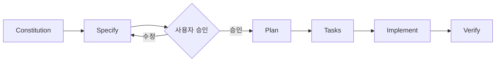

<div align="center">

# ✊ RPS Lab

### A small game. A deliberate engineering process.

**가위바위보 하나를 만들기 위해, 우리는 어디까지 설계해야 할까?**

RPS Lab은 단순한 가위바위보 웹 게임을 소재로 **Spec-Driven Development(SDD)**와 **AI 에이전트 기반 개발 워크플로**를 실험하는 프로젝트입니다.

코드를 얼마나 빠르게 생성하는지보다, **무엇을 만들지 명확히 정의하고, 설계의 타당성을 검토하고, 결과를 검증하는 과정**에 집중합니다.

[개발 방식](#-개발-방식) · [핵심 원칙](#-핵심-원칙) · [문서](#-프로젝트-문서) · [진행 현황](#-진행-현황)

</div>

---

## 🎯 왜 이 프로젝트를 시작했나

AI를 활용하면 간단한 게임은 빠르게 구현할 수 있습니다. 하지만 **동작하는 코드가 곧 올바르게 설계된 코드인 것은 아닙니다.**

요구사항이 모호한 채로 구현을 시작하면, AI가 빈틈을 임의로 채우거나 구현 이후에 예상하지 못한 동작을 발견할 수 있습니다. 반대로 모든 세부사항을 미리 고정하는 것도 비효율적입니다.

이 프로젝트에서는 작은 문제를 대상으로 다음 질문을 검증합니다.

- **명세:** 구현 전에 사용자 동작과 예외 상황을 어디까지 정의해야 할까?
- **설계:** 요구사항과 기술적 구현 결정을 어떻게 분리할까?
- **검증:** 작성한 인수 조건이 실제 테스트와 연결되는가?
- **협업:** AI 에이전트가 제안한 설계를 개발자는 어떤 기준으로 승인하거나 수정해야 할까?
- **효율:** 불필요한 추상화와 에이전트 호출을 줄이면서 품질을 확보할 수 있을까?

목표는 SDD가 언제나 정답이라고 주장하는 것이 아닙니다. **작은 프로젝트에서 적용해 보고, 효과와 비용을 함께 관찰하는 것**입니다.

## 🧭 개발 방식

이 프로젝트는 [GitHub Spec Kit](https://github.com/github/spec-kit)을 사용해 다음 흐름으로 진행합니다.



| 단계 | 역할 | 주요 산출물 |
| --- | --- | --- |
| **Constitution** | 프로젝트 전체에 적용할 개발 원칙 정의 | [constitution.md](.specify/memory/constitution.md) |
| **Specify** | 사용자 관점의 기능 요구사항과 인수 조건 명세 | [spec.md](specs/001-rps-game/spec.md) |
| **Plan** | 기술 선택, 상태 관리, 저장 방식, 테스트 전략 설계 | [plan.md](specs/001-rps-game/plan.md) |
| **Tasks** | 구현 작업과 의존성, 완료 기준 분해 | [tasks.md](specs/001-rps-game/tasks.md) |
| **Implement** | 승인된 설계를 기준으로 구현 | 진행 예정 |
| **Verify** | 자동 테스트와 수동 검증으로 인수 조건 확인 | 진행 예정 |

> **핵심 규칙:** 승인되지 않은 기능을 임의로 구현하지 않습니다. 명세를 변경해야 한다면 먼저 이유와 영향을 검토하고 승인을 받습니다.

## 🪨 만들 게임

사용자가 컴퓨터와 가위바위보를 반복해서 즐기는 반응형 웹 게임을 목표로 합니다.

**계획된 기능**

- 가위·바위·보 선택 및 컴퓨터의 무작위 선택
- 모든 선택 조합에 대한 승리·패배·무승부 판정
- 가장 최근 라운드의 결과 표시
- 승·패·무 누적 전적과 즉시 초기화
- 동일 브라우저에서 새로고침 후에도 전적 유지
- 빠른 연속 입력, 키보드 조작, 모바일·데스크톱 대응

로그인, 데이터베이스, 별도 백엔드는 도입하지 않습니다. 누적 전적은 브라우저의 로컬 저장소를 사용하도록 설계했습니다.

**현재 위 기능들은 승인된 요구사항이며, 구현 완료를 의미하지 않습니다.** 상세 조건과 예외 처리는 [기능 명세](specs/001-rps-game/spec.md)를 참고해 주세요.

## 🧱 핵심 원칙

프로젝트의 [Constitution v2.1.0](.specify/memory/constitution.md)을 기준으로 개발합니다.

1. **명세 우선:** 사용자에게 보이는 기능은 승인된 Spec을 따릅니다.
2. **단순성 우선:** 작은 실험에 불필요한 의존성과 추상화를 추가하지 않습니다.
3. **순수 로직 분리:** 승패 판정은 UI와 분리하고, 무작위 값은 주입 가능하게 설계합니다.
4. **검증 가능한 요구사항:** 기능 요구사항(FR)을 인수 조건(AC)에 연결합니다.
5. **완료 기준 명확화:** 타입 검사, 린트, 테스트를 통과해야 완료로 판단합니다.
6. **비용 효율:** 기본적으로 메인 에이전트 하나를 사용하고, 서브에이전트는 필요할 때만 도입합니다.

## 🧰 기술 스택과 도구

| 구분 | 선택 | 상태 |
| --- | --- | --- |
| 웹 프레임워크 | Next.js App Router | 구현 계획 |
| UI | React · TypeScript | 구현 계획 |
| 스타일 | CSS Modules | 구현 계획 |
| 테스트 | Vitest · React Testing Library | 구현 계획 |
| 명세 기반 워크플로 | GitHub Spec Kit | 문서 작성에 사용 |
| AI 개발 도구 | Claude Code | 설계·작업 분해에 사용 |
| 버전 관리 | Git · GitHub · SourceTree | 사용 중 |

## 📁 프로젝트 문서

구현 코드뿐 아니라 **왜 그렇게 구현하기로 했는지** 추적할 수 있도록 설계 문서를 저장소에 함께 보관합니다.

```text
.specify/
└── memory/
    └── constitution.md

specs/
└── 001-rps-game/
    ├── spec.md
    ├── plan.md
    ├── research.md
    ├── data-model.md
    ├── quickstart.md
    ├── tasks.md
    ├── checklists/
    │   └── requirements.md
    └── contracts/
        ├── ui-contract.md
        └── storage-contract.md
```

- [기능 명세 — spec.md](specs/001-rps-game/spec.md): 사용자 시나리오, 기능 요구사항, 인수 조건
- [구현 계획 — plan.md](specs/001-rps-game/plan.md): 아키텍처와 구현 전략
- [작업 목록 — tasks.md](specs/001-rps-game/tasks.md): 작업 순서, 의존성, 완료 기준
- [기술 검토 — research.md](specs/001-rps-game/research.md): 기술 선택과 대안
- [데이터 모델 — data-model.md](specs/001-rps-game/data-model.md): 게임 상태와 저장 데이터
- [UI 계약](specs/001-rps-game/contracts/ui-contract.md) · [저장소 계약](specs/001-rps-game/contracts/storage-contract.md)

## 🚦 진행 현황

| 단계 | 상태 |
| --- | --- |
| 프로젝트 초기화 및 Spec Kit 구성 | ✅ 완료 |
| Constitution 정의 | ✅ 완료 |
| Spec 작성 및 승인 | ✅ 완료 |
| Plan 작성 및 검토 | ✅ 완료 |
| Tasks 작성 | ✅ 완료 |
| Next.js 애플리케이션 구현 | ⏳ 예정 |
| 자동 테스트 및 수동 검증 | ⏳ 예정 |

> 이 표는 README 작성 시점의 상태입니다. 최신 진행 내용은 [커밋 이력](https://github.com/HyeonSeoMan/rps-lab/commits)과 [Tasks](specs/001-rps-game/tasks.md)를 기준으로 확인해 주세요.

## 🔬 이번 실험에서 관찰할 것

게임이 동작하는지뿐 아니라 다음 항목도 회고할 계획입니다.

- Spec 검토 과정에서 발견한 모호성과 요구사항 충돌
- Plan 검토 과정에서 발견한 설계 문제와 수정 이유
- FR/AC와 실제 테스트 사이의 추적 가능성
- AI가 생성한 코드의 수정·재작업 횟수
- 에이전트 사용량과 작업 복잡도 사이의 균형

성공 사례뿐 아니라 **예상과 달랐던 결정, 불필요했던 절차, 남은 한계**도 기록합니다.

## ▶️ 실행 방법

현재는 설계 및 작업 분해 단계로, 실행 가능한 Next.js 애플리케이션이 아직 준비되지 않았습니다.

구현이 완료되면 설치 명령, 로컬 실행 방법, 테스트 명령을 이곳에 추가할 예정입니다.

## ✍️ 개발 기록

이 프로젝트의 주요 설계 결정과 구현 과정은 Git 커밋을 기준으로 정리하고, 개발 블로그에 연재할 계획입니다.

- [Velog — 개발 블로그](https://velog.io/@rmsry123/posts)
- [GitHub — 커밋 이력](https://github.com/HyeonSeoMan/rps-lab/commits)

---

<div align="center">

**코드를 생성하는 속도보다, 무엇을 왜 만들었는지 설명할 수 있는 개발을 지향합니다.**

</div>
