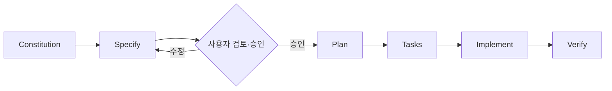

<div align="center">

# ✊ RPS Lab

### A small game. A deliberate engineering process.

**가위바위보 하나를 만들기 위해, 우리는 어디까지 설계해야 할까?**

RPS Lab은 가위바위보 웹 게임을 만들면서 **Spec-Driven Development(SDD)**와 **Claude Code 기반 개발 워크플로**의 효과와 비용을 함께 살펴보는 실험 프로젝트입니다.

빠르게 코드를 만드는 것보다 **요구사항을 정의하고, 설계를 검토하고, 결과를 검증하는 과정**에 집중했습니다.

### 🔗 [**라이브 데모 — hyeonseoman.github.io/rps-lab**](https://hyeonseoman.github.io/rps-lab/)

[게임 기능](#-게임-기능) · [개발 방식](#-개발-방식) · [검증 현황](#-검증-현황) · [로컬 실행](#-로컬-실행) · [배포](#-배포-github-pages)

</div>

---

## 🎯 왜 만들었나

AI에게 가위바위보 게임을 만들어 달라고 요청하면 결과물은 빠르게 나올 수 있습니다. 하지만 **동작하는 코드가 곧 요구사항에 맞는 코드라는 뜻은 아닙니다.**

작은 프로젝트를 대상으로 다음을 실험했습니다.

- **명세:** 사용자의 동작과 예외 상황을 구현 전에 어디까지 정의해야 할까?
- **설계:** 기능 요구사항과 기술적 선택을 어떻게 구분할까?
- **검증:** 인수 조건을 테스트와 실제 브라우저 검증으로 추적할 수 있을까?
- **협업:** AI의 제안을 언제 승인하고, 언제 수정해야 할까?
- **효율:** 문서화와 검증의 이점이 추가로 드는 시간·사용량에 비해 충분할까?

SDD가 모든 프로젝트의 정답이라고 주장하기보다, **어디서 도움이 됐고 어디서 과했는지** 확인하는 것이 목표입니다.

## 🕹️ 게임 기능

| 기능 | 설명 |
| --- | --- |
| 수동 대결 | 가위·바위·보를 선택해 컴퓨터와 대결하고 결과 확인 |
| 자동 시뮬레이션 | 10·100·1,000회 대결을 즉시 실행하거나 애니메이션으로 진행 |
| 자동 실행 중지 | 애니메이션 실행 중 중지하고 확정된 대결만 기록 |
| 전적과 통계 | 승·패·무 누적 수치, 비율 및 실행 결과 요약 |
| 대결 기록 | `/history/`에서 최신순 기록 조회, 페이지당 20건 |
| 기록 초기화 | 확인 대화상자를 거쳐 전적과 기록을 함께 초기화 |
| 저장 실패 대응 | 저장이 불가능할 때 기록되지 않는 연습 대결과 명시적 재시도 제공 |
| 반응형·키보드 조작 | 모바일·데스크톱 레이아웃, 키보드 접근 및 상태 안내 |

전적과 대결 기록은 **브라우저의 IndexedDB**에 저장됩니다. 로그인, 별도 백엔드, 외부 데이터베이스는 사용하지 않습니다. 다른 기기·브라우저 사이에 기록이 동기화되지는 않습니다.

## 🧭 개발 방식

[GitHub Spec Kit](https://github.com/github/spec-kit)을 사용해 다음 흐름으로 진행했습니다.



| 단계 | 목적 | 주요 문서 |
| --- | --- | --- |
| Constitution | 프로젝트 전반의 개발 원칙 | [constitution.md](.specify/memory/constitution.md) |
| Specify | 사용자 동작, 예외, 인수 조건 정의 | [v1 Spec](specs/001-rps-game/spec.md) · [v2 Spec](specs/002-rps-simulation-stats/spec.md) |
| Plan | 기술 선택과 구현·검증 전략 설계 | [v2 Plan](specs/002-rps-simulation-stats/plan.md) |
| Tasks | 실행 단위와 완료 조건 분리 | [v2 Tasks](specs/002-rps-simulation-stats/tasks.md) |
| Implement | 승인된 문서를 기준으로 단계별 구현 | [커밋 이력](https://github.com/HyeonSeoMan/rps-lab/commits/master) |
| Verify | 테스트·브라우저 검증·요구사항 추적 | [verification.md](specs/002-rps-simulation-stats/verification.md) |

**역할 분담:** 개발자는 요구사항·설계의 방향을 결정하고 결과를 검토했습니다. Claude Code는 문서 작성 보조, 구현, 테스트와 검증을 수행했습니다. 커밋과 Push는 개발자가 직접 관리했습니다.

> **핵심 원칙:** 승인되지 않은 사용자 기능을 임의로 추가하지 않고, 요구사항 변경은 영향과 근거를 먼저 확인합니다. 테스트 통과와 실제 배포 성공도 별개의 완료 조건으로 취급합니다.

## 🎨 디자인 레퍼런스

UI는 처음에 **정적 HTML/CSS 레퍼런스**로 구성했습니다. 이후 **Figma MCP**를 이용하는 흐름을 시도했지만 사용량 제한으로 계속 진행하기 어려워, 저장소에서 직접 읽고 수정할 수 있는 HTML 레퍼런스로 돌아왔습니다.

- [v1 UI 레퍼런스](docs/references/rps-ui-reference.html)
- [v2 UI 레퍼런스](docs/references/rps-lab-v2-ui.html)

이 HTML 파일은 **디자인 참고 자료**이며 실제 앱 소스가 아닙니다. 화면의 시각적 표현은 레퍼런스를 참고하고, 동작·예외·접근성의 기준은 승인된 Spec과 계약 문서에 둡니다.

이 과정에서 외부 도구가 막혀도 **버전 관리되는 파일을 통해 작업을 이어갈 수 있는 대체 경로**의 중요성을 확인했습니다.

## 🧱 기술 스택과 설계 선택

| 구분 | 사용 기술 |
| --- | --- |
| 프레임워크 | Next.js App Router, React, TypeScript |
| 스타일 | CSS Modules |
| 저장 | IndexedDB (브라우저 로컬) |
| 테스트 | Vitest, React Testing Library, fake-indexeddb |
| 개발 워크플로 | GitHub Spec Kit, Claude Code |
| 버전 관리 | Git, GitHub, SourceTree |
| 배포 구성 | Next.js Static Export, GitHub Actions, GitHub Pages |

**주요 설계 판단**

- 승패 판정 등 핵심 로직을 UI에서 분리하고 난수·타이머·저장소를 테스트 가능하게 구성했습니다.
- IndexedDB에 대결 기록과 통계를 일관되게 반영하도록 저장 순서와 트랜잭션을 관리합니다.
- 기록 목록은 페이지당 20건을 읽고, 통계는 별도로 관리해 기록이 늘어나도 전체 목록을 불러오지 않습니다.
- 저장 실패와 기록 조회 실패를 구분합니다. 저장이 불가능한 경우에만 기록 없는 연습 대결로 전환하고, 복구는 사용자의 명시적 재시도로 처리합니다.
- 정적 호스팅을 택해 별도 서버와 유료 인프라 없이 배포할 수 있도록 설계했습니다.

세부적인 근거와 제약은 [v2 Plan](specs/002-rps-simulation-stats/plan.md)과 [저장소 계약](specs/002-rps-simulation-stats/contracts/storage-contract.md)에 기록했습니다.

## 📁 프로젝트 문서

| 문서 | 내용 |
| --- | --- |
| [Constitution](.specify/memory/constitution.md) | 개발 원칙과 승인·검증 기준 |
| [v1 Spec](specs/001-rps-game/spec.md) | 기본 수동 가위바위보 요구사항 |
| [v2 Spec](specs/002-rps-simulation-stats/spec.md) | 자동 시뮬레이션·통계·기록·실패 대응 요구사항 |
| [v2 Plan](specs/002-rps-simulation-stats/plan.md) | 아키텍처, 저장 모델, 접근성, 배포 설계 |
| [v2 Tasks](specs/002-rps-simulation-stats/tasks.md) | 구현 단계와 완료 기준 |
| [v2 검증 기록](specs/002-rps-simulation-stats/verification.md) | 요구사항 추적, 테스트, 브라우저·성능 검증 및 한계 |
| [v2 Quickstart](specs/002-rps-simulation-stats/quickstart.md) | 수동 검증과 배포 확인 절차 |
| [UI 레퍼런스](docs/references/rps-lab-v2-ui.html) | 구현 참고용 HTML/CSS 화면 |

## 🧪 검증 현황

**로컬 검증은 2026-11-05 기준, 배포 확인은 2026-11-06 기준**

| 항목 | 상태 |
| --- | --- |
| v2 작업 목록 | **41 / 43 완료** |
| 타입 검사 · ESLint | 통과 |
| 자동 테스트 | **277개 / 16개 파일 통과** |
| Next.js 빌드 · Pages 정적 빌드 | 통과 |
| Chrome headless 자동 검증 | 주요 화면·상태·저장·키보드 흐름 확인 |
| GitHub Pages 배포 | **성공** — [라이브 사이트](https://hyeonseoman.github.io/rps-lab/)와 `/history/` 모두 HTTP 200 응답 확인 |
| 배포 후 상세 검증(Quickstart D-02~D-12, 롤백 리허설) | **미완료** |
| Safari·Firefox·실기기·스크린리더 검증 | **미완료** |

마지막 두 작업은 [T040(브라우저·보조기술 수동 검증)](specs/002-rps-simulation-stats/tasks.md)과 [T042(실제 배포 후 검증)](specs/002-rps-simulation-stats/tasks.md)입니다.

Chrome headless에서 기록 1,000건과 100,000건에 대한 조회 성능, 자동 실행·중지 응답성 등을 측정했습니다. **측정 환경이 제한적이고 성능 목표가 아직 확정되지 않았으므로 합격 수치로 일반화하지 않습니다.** 상세 값과 미검증 항목은 [verification.md](specs/002-rps-simulation-stats/verification.md)를 참고해 주세요.

또한 일부 버튼 테두리의 비텍스트 대비가 3:1에 미치지 못하는 점을 기록했으며, 실제 보조기술 사용성은 추가 확인이 필요합니다.

## ▶️ 로컬 실행

Node.js 22 환경을 기준으로 작업했습니다.

```bash
npm install
npm run dev
```

- 게임: `http://localhost:3000/` (배포: https://hyeonseoman.github.io/rps-lab/)
- 기록·통계: `http://localhost:3000/history/` (배포: https://hyeonseoman.github.io/rps-lab/history/)

품질 검사 및 정적 배포 빌드:

```bash
npm run typecheck
npm run lint
npm test
npm run build:pages
npm run preview:pages
```

`preview:pages`는 빌드 결과인 `out/`을 `http://localhost:4173/rps-lab/`에서 제공해 GitHub Pages 경로를 **로컬에서 근사**합니다. 실제 GitHub Pages의 캐시·리다이렉트 등과 완전히 같지는 않습니다.

정적 내보내기(`output: "export"`)를 사용하므로 **`npm start` (`next start`)는 실행 방식으로 지원하지 않습니다.**

## 🚀 배포 (GitHub Pages)

무료 GitHub Pages로 배포했습니다. **배포에 성공했으며 아래 주소에서 바로 플레이할 수 있습니다.**

**🌐 배포 주소:** https://hyeonseoman.github.io/rps-lab/

- 게임: https://hyeonseoman.github.io/rps-lab/
- 기록·통계: https://hyeonseoman.github.io/rps-lab/history/

배포 절차는 다음과 같습니다.

1. 저장소 **Settings → Pages → Build and deployment → Source**를 **GitHub Actions**로 설정합니다.
2. `master`에 Push하면 [deploy-pages.yml](.github/workflows/deploy-pages.yml)이 타입 검사·린트·테스트·정적 빌드를 실행한 후 Pages 배포를 시도합니다.
3. [Actions](https://github.com/HyeonSeoMan/rps-lab/actions)에서 성공 여부를 확인합니다.
4. 배포 후 실제 주소에서 게임과 기록 페이지 직접 진입·새로고침을 확인하고 [Quickstart 7절](specs/002-rps-simulation-stats/quickstart.md)의 D-02~D-12 및 롤백 절차를 검증합니다. (두 페이지의 응답은 확인했으며, 나머지 상세 항목은 아직 수행하지 않았습니다.)

배포 빌드에서만 `basePath`를 `/rps-lab`으로 적용하며 `trailingSlash`를 사용합니다. 저장소 이름을 변경하면 `build:pages`와 배포 경로도 함께 수정해야 합니다.

배포에 문제가 있다면 Actions 로그의 실패 단계, Pages Source 설정, 정적 자산의 `/rps-lab/` 경로를 확인합니다. 문제 있는 커밋은 `git revert` 후 다시 Push하는 방식으로 되돌릴 수 있도록 설계했으며, **실제 롤백 리허설은 아직 수행하지 않았습니다.**

## 🔬 실험에서 얻은 관찰

- **명세는 구현을 빠르게 시작하는 수단이자 검증 기준**이었지만, Plan을 과도하게 상세히 검토하는 과정은 작은 프로젝트에서 병목이 될 수 있었습니다.
- **검증은 구현과 별개의 작업**입니다. 자동 테스트가 통과해도 브라우저·보조기술·실제 배포 검증까지 완료한 것은 아닙니다.
- **도구에 대한 의존성에도 대안이 필요**했습니다. Figma MCP 사용량 제한 후 HTML 레퍼런스로 복귀해 작업을 이어갔습니다.
- **AI 사용 비용도 함께 측정**했습니다. 커밋 간 시간과 Claude 세션 사용량을 기록하되, 이를 순수 개발 시간이나 정확한 작업별 토큰 비용으로 해석하지 않습니다.

작업의 상세한 결정과 수정 이력은 [GitHub 커밋](https://github.com/HyeonSeoMan/rps-lab/commits/master) 및 저장소의 Spec·Plan·검증 문서에서 확인할 수 있습니다.

## ✍️ 개발 기록

이번 실험의 설계 결정, 시행착오, 작업 시간과 AI 사용량은 별도로 정리하고 있습니다. 공개 회고는 개발 블로그에 공유할 예정입니다.

- [Velog — 개발 블로그](https://velog.io/@rmsry123/posts)
- [GitHub — 커밋 이력](https://github.com/HyeonSeoMan/rps-lab/commits/master)

---

<div align="center">

**코드를 얼마나 빨리 만들었는지보다, 무엇을 왜 만들었는지 설명할 수 있는 개발을 지향합니다.**

</div>
